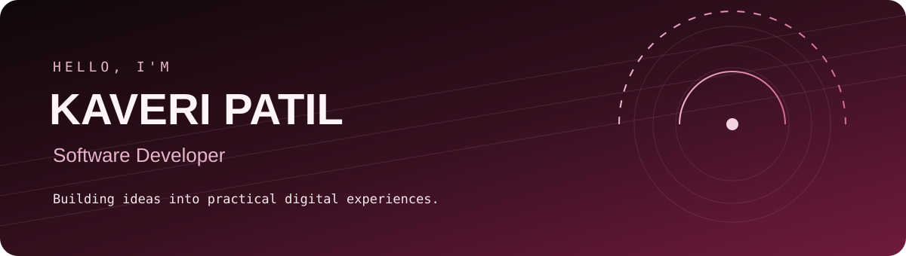

<!-- Profile README for kaveripatil04 | Accent: #BF4B8A -->

<div align="center">
  
</div>

<div align="center">
  <a href="https://github.com/kaveripatil04"></a>
  <a href="mailto:kaverispatil2004@gmail.com"></a>
</div>

## Who I Am

```typescript
const kaveri = {
  title: "Software Developer | Computer Engineering",
  stack: ["Java", "JavaScript", "C", "C++", "React.js", "HTML", "CSS", "MySQL"],
  launchedProjects: ["AI-Powered Code Corrector", "MedicareHub"],
  certifications: [],
  status: "Learning and building software projects",
  openTo: []
};
```

## Featured Projects

### AI-Powered Code Corrector
A web application that identifies programming errors and provides correction suggestions to help users learn and debug.
- Detects syntax and logical errors across supported programming languages
- Explores rule-based analysis and machine-learning techniques
- **Tech:** Python, Django, HTML, CSS, JavaScript, Machine Learning
  
| Layer | Technology |
|---|---|
| Languages | Python, C, C++, Java |
| Analysis | AST parsing, rule-based analysis, pattern matching |
| Machine Learning | TF-IDF, KNN |
| Tools | Django, GCC, javac |

<!--- [Code](https://github.com/kaveripatil04/AI-Powered-Code-Corrector)-->

### MedicareHub
A healthcare web application designed to bring patients, doctors, and pharmacies together in one platform.
- Appointment booking, medicine ordering, and patient-record management
- Database operations and user interactions for healthcare workflows
- Focused on simplifying communication between patients and providers

| Layer | Technology |
|---|---|
| Project | MedicareHub |

<!--- [Code](https://github.com/kaveripatil04/MedicareHub)-->

## Tech Stack

### Languages

[](https://skillicons.dev)

### Frontend

[](https://skillicons.dev)

### Backend / Infra

[](https://skillicons.dev)

### Cloud

[](https://skillicons.dev)

### AI / DB

[](https://skillicons.dev)

### Dev Tools

[](https://skillicons.dev)

## GitHub Stats

<div align="center">
  
  <br />
  
</div>

## Streak Stats

<div align="center">
  
</div>

## GitHub Trophies

<div align="center">
  
</div>

## Contribution Activity

<div align="center">
  
</div>

## ✦ Education

**Bachelor of Engineering — Computer Engineering**  
D. N. Patel College of Engineering, Shahada

## ✦ Languages

- Marathi — Native
- Hindi — Advanced
- English — Proficient

## Connect

- GitHub: [@kaveripatil04](https://github.com/kaveripatil04)
- Email: [kaverispatil2004@gmail.com](mailto:kaverispatil2004@gmail.com)

<div align="center">
  
</div>
